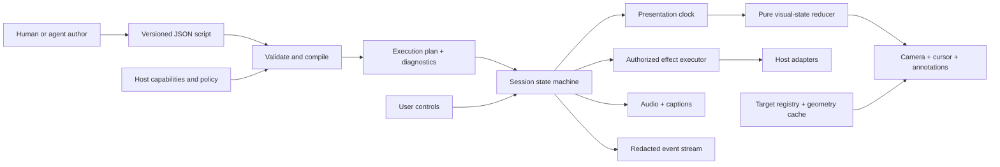

# 04 · Architecture and runtime ownership

## System boundary



The compiler handles declarative intent; the runtime handles a measured, changing host; policy stays host-owned. The proposed core has no network client or model SDK.

## Components

**Script compiler.** Parse trusted-size JSON, validate the known schema version, reject unknown operation kinds, resolve symbolic IDs and timing anchors, check scene transitions, identify effect barriers, and compute required capabilities. Emit a normalized plan and diagnostics with JSON Pointer paths. It never invokes application actions or fetches arbitrary URLs to validate a script.

**Target registry.** Maps stable IDs to lazy resolvers. Each resolver declares scope, visibility, accessible label, sensitivity, geometry kind, and optional reveal capability. DOM replacement is expected: storing a selector's first element forever is incorrect. Resolve at bounded invalidation points, not by scanning the entire DOM each frame.

**Geometry service.** Maintains coordinate-space and layout revision IDs. Batches reads before writes. It observes approved target containers and scroll ancestors, not every node in the document. It can use host-provided geometry for virtualized or non-DOM targets. A DOM mutation is an invalidation signal, not proof that an element is visible or stable.

**Session reducer.** Owns state transitions and the selected path through a branching script. Reducer inputs include commands, clock samples, geometry revisions, asset status, host events, and effect results. It emits desired presentation state plus explicit effect requests. It does not perform I/O.

**Clock coordinator.** Chooses a single presentation-time authority for the current segment. It maps media time to scene time, freezes on gates and buffering, and resynchronizes after pause, tab visibility changes, or playback-rate changes. Independent animation timers are not allowed to become competing clocks.

**Renderer.** Writes engine-owned transforms and overlay styles. It is replaceable: an overlay-only renderer can support narration and guidance without transforming the app. Optional Web Animations integration must obey the coordinator's time, interruption, and cleanup semantics.

**Effect executor.** Executes only named, host-registered actions after authorization, preconditions, and any required real-user confirmation. It enforces cancellation, timeouts, idempotency contracts, and a run-local effect ledger. It reports ambiguous outcomes instead of retrying them blindly.

**Media coordinator.** Prepares allowed audio assets, captions, and transcript. Missing audio does not erase the textual explanation. Paused, buffering, and gate states are explicit. Speech synthesis is an optional best-effort adapter, not the source of deterministic word timings.

**Controls and accessibility.** Separate UI outside the camera scene. The controls are not part of the script's transform, hit mask, or hiding policy. They expose the same command surface as programmatic controls while preserving keyboard and assistive-technology behavior.

**Host adapters.** Targets, routing, actions, conditions, checkpoints, fixture resets, assets, and optional native cameras. Their implementations stay in application code. A script names capabilities but cannot define executable callbacks.

## DOM integration contract

```html
<div class="tour-viewport">
  <div class="tour-scene"><!-- existing application root --></div>
</div>
<div class="tour-overlay"><!-- player, captions, annotations --></div>
```

The host creates the wrapper intentionally. Avoid automatic reparenting of existing application DOM: selectors, event delegation, framework roots, layout, and fixed descendants may depend on ancestry. Do not toggle surface geometry merely to start playback. Establish the surface once and measure its baseline before applying motion. Native top-layer UI is not guaranteed to behave like ordinary descendants; see [06](06-camera-and-geometry.md).

In the full-viewport integration the scene's baseline dimensions match the app's existing layout viewport. A clipped visual viewport hides camera overflow without resizing the app during the shot. Embedded scenes use their own explicit layout contract. A resize is a real layout event and is handled separately from camera motion.

## Exclusive ownership

The host must not animate the same scene transform while the director owns it. Do not concatenate a preexisting animated transform string and hope it stays correct. Prefer a dedicated wrapper. A camera lease identifies the property owner and expires on teardown. Native map cameras have their own lease; the script must not unintentionally zoom both the page and map to achieve the same shot.

One session is permitted per surface in P0. Multiple sessions may coexist on independent surfaces, but overlays and keyboard shortcuts need scoping. Global media focus and duplicate keyboard bindings are P1 integration concerns.

## Lifecycle

`create → load → prepare → ready → play/pause/wait/seek → complete → destroy`.

Creation validates elements without mutating host state. Loading parses script data. Preparation resolves approved capabilities and assets and produces a readiness report. Play begins only when prerequisites are satisfied. Destroy is idempotent and releases observers, listeners, animations, audio, pointer decorations, timers, subscriptions, and owned styles.

Each async operation receives an AbortSignal and an epoch. A result from an older epoch is ignored even when its underlying operation cannot be aborted. Effects that have already reached an external service may still complete; cancellation is not rollback.

## Restoration journal

Track exact original inline property values and priorities for engine-owned styles, owned attributes, scroll positions the engine deliberately changed, and the element focused by the engine. Restore only a property still carrying the engine's last value; do not overwrite unrelated host changes. Restore focus only when appropriate and the target is still connected. Host business data changes are never covered by the DOM restoration journal.

## Module plan

Begin with one source package with explicit internal modules: schema/plan, session, clock, geometry, renderer, media, controls, adapters. Publish split entry points only after measuring tree-shaking and actual adopter needs. Optional React bindings, agent transport, authoring studio, and recording/export tools stay outside the minimal runtime dependency graph. A monorepo is a distribution decision, not an architectural prerequisite.

## Observability

Every event has run ID, monotonically increasing sequence, scene ID, visit ID, scene time, wall timestamp, command correlation, and redacted detail. Never send events anywhere by default. Distinguish `visual-settled`, `condition-satisfied`, `action-completed`, and `scene-completed`; one does not imply another.

## Failure boundaries

A missing optional annotation may be omitted with a warning. A missing required target pauses or takes its explicitly declared fallback. A failed required action blocks progression. A media failure offers text-only continuation. An invalid policy or schema rejects the script before running. A lost surface destroys its renderer and leaves controls available long enough to explain the interruption.
